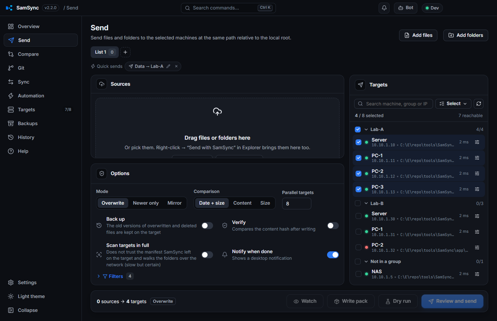
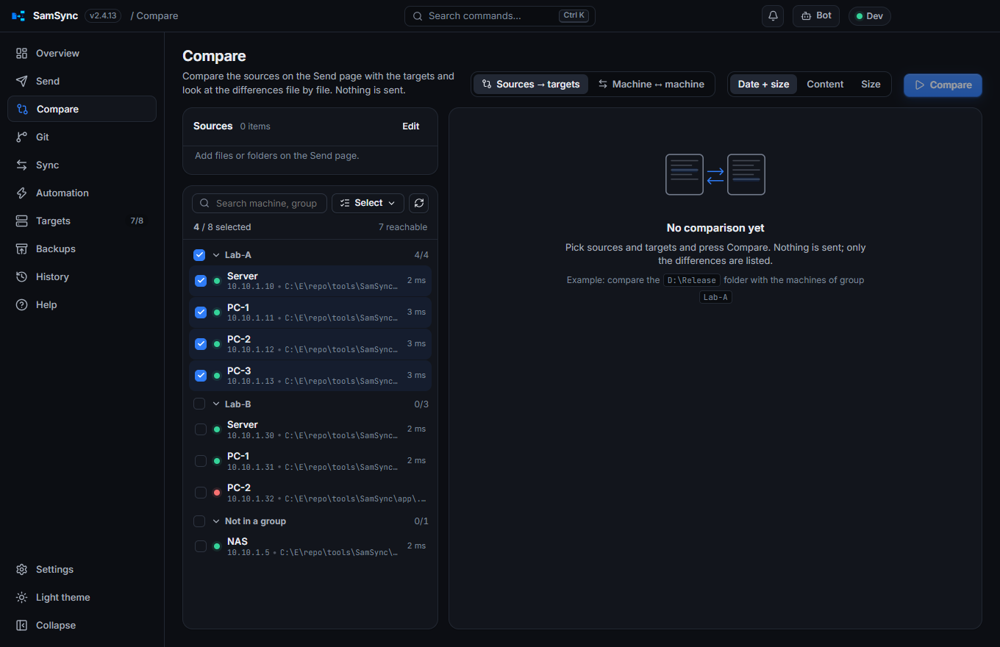
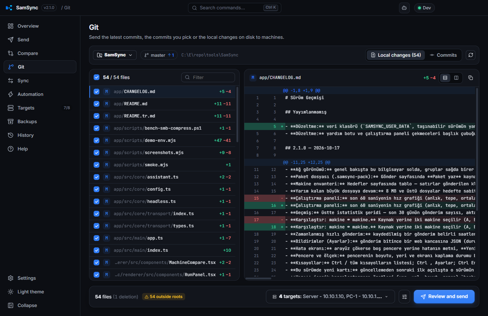
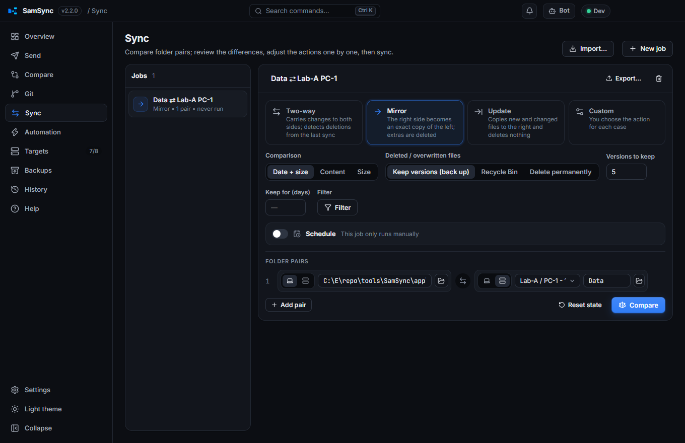
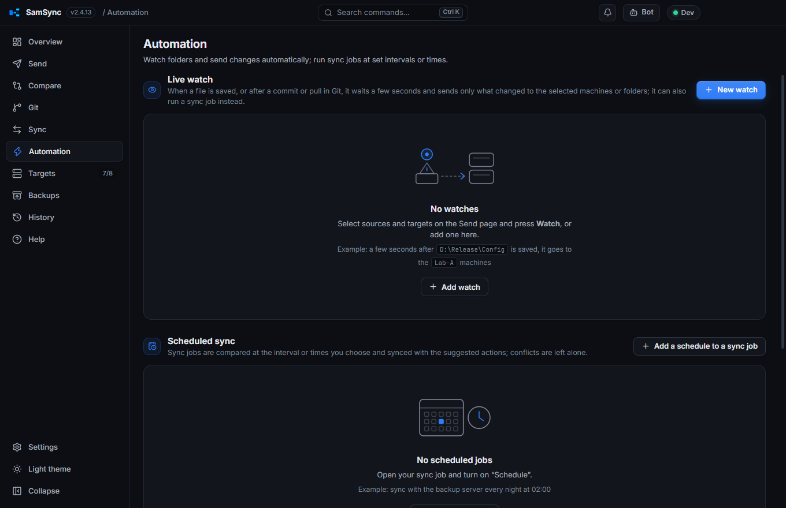
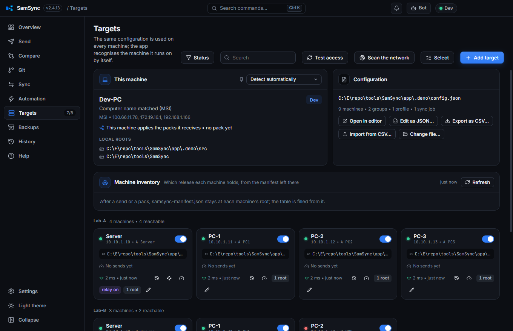
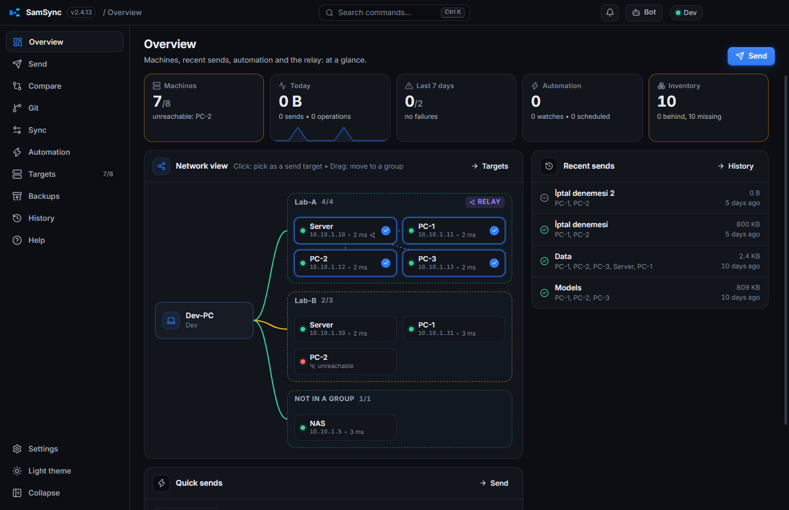
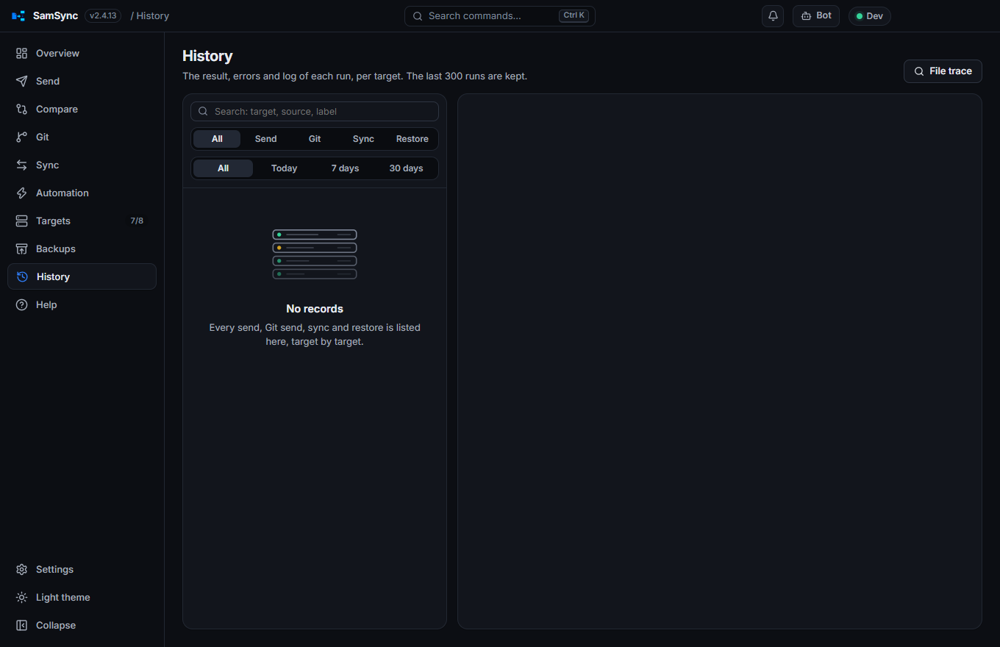

# SamSync

[Türkçe](README.tr.md)

A desktop app that sends files, folders and Git changes to many machines at **the same relative path**, compares and synchronizes targets, sends changes automatically, and rolls them back when needed. Runs on Windows, macOS and Linux (Electron + React + TypeScript).

It replaces the old PowerShell tool ([`../legacy`](../legacy/README.md)) and reads that tool's `config.json` as is.

The user interface is in Turkish, English, German and Spanish. It follows the computer's display language (Turkish, German or Spanish when the system uses one of them, English for anything else) unless one is picked under Settings → **Language**; the help content (FAQ, this README) is in Turkish and English, and the German and Spanish UI shows the English one. This README names buttons, pages and settings by the labels of the English interface, e.g. **Send**.

## Screenshots

| | |
| --- | --- |
|  |  |
|  |  |
|  |  |
|  |  |

## Installation

`npm run dist:win` produces three files in `release/<version>/`:

| File | When to use |
| --- | --- |
| `SamSync-Setup-<version>.exe` | Recommended. Installs per user (no admin rights needed), creates Start menu and desktop shortcuts, **updates itself**. |
| `SamSync-<version>-portable.exe` | No installation, a single file. Can run from a USB stick or a share; it unpacks itself on every start and cannot update itself. |
| `SamSync-<version>-win.zip` | No installation, the unpacked app: extract it anywhere and run `SamSync.exe`; starts faster than the single file. Cannot update itself. |

The two portable forms keep their settings, history and logs in a `SamSync-data` folder next to the program, so they travel with it and are there on the next start. If that folder cannot be written (a read-only share), the per-user folder of the installed app is used.

**Checking a download.** Every release has a `SHA256SUMS.txt` with the SHA-256 of each file: `Get-FileHash SamSync-Setup-<version>.exe` on Windows, `shasum -a 256 -c SHA256SUMS.txt` on macOS and Linux. `npm run winget` writes the [winget](https://learn.microsoft.com/windows/package-manager/) manifests of a published version (`packaging/winget/<version>/`, identifier `SametKurumahmut.SamSync`), to be proposed to `microsoft/winget-pkgs`.

macOS (`.dmg`) and Linux (`.AppImage`) packages have to be built on their own operating systems; GitHub Actions builds all three (see *Publishing a release* below).

## First start

Without a configuration, the welcome screen offers four ways in:

- **Setup wizard** — three steps: this machine (name, the address the others reach it at, the folder it sends from, its share root), the machines found on the network (every address of this computer's subnets is tried on file sharing, port 445, and SSH, port 22; their names, on Windows their shares, and the ones already configured are shown; tick the targets), then a look at the list before it is saved as the configuration.
- **Use an existing config.json** — the shared file on a network share, or the old tool's `legacy/config.json`. The app writes its changes to that file and keeps the old tool's fields (`version`, `menuTitle`, `notepadPlusPlusShortcuts`…), so the PowerShell tool keeps working with the same file.
- **Import a copy** — copies the machines into this computer's own configuration.
- **Add by hand** — add the machines one by one on the **Targets** page. **Scan the network** there finds the machines that answer and opens the editor filled in for the one you pick.

The app recognises the machine it runs on with the same rules as the old tool: the `SAMSYNC_NODE_ID` environment variable, the IP address, the computer name (`address` / `localNames`, as the bare name or, on a domain, as `<name>.<USERDNSDOMAIN>`), and, when several nodes match, the one whose local root exists here. The machine can also be pinned by hand on the Targets page.

Node ids and group names may only contain letters, digits, dots, underscores and hyphens (`Lab-A`, no spaces), because they are used as machine ids and `group:<name>` on command lines and in the menus. As with the old tool, a config that breaks this rule is not loaded.

## Pages

### Overview
The first page (Ctrl 1): tiles for the machines (reachable / total, who is down), today's volume with a 14-day sparkline, the week's failed sends, the automation, the inventory and, when there is one, the relay and a pending update; below them the recent sends, the quick sends, the watches and the scheduled jobs. The **network view** draws this computer on the left and the groups on the right: a line to each group coloured by how many of its machines answer, the relay marked with dashed lines to the machines it distributes to. Click a machine to pick it as a send target, drag it into another group to move it there.

### Send
Drag files/folders onto the window, pick them, or paste a path; then choose targets (groups, search, reachability dots, profiles, "failed in the last run"). **Review and send** shows, file by file, what will happen on each target:

| Sign | Meaning |
| --- | --- |
| `+` | not on the target yet, new |
| `~` | will be updated |
| `!` | the file on the target is **newer** (written in *Overwrite* mode, skipped in *Newer only* mode) |
| `−` | extra on the target (deleted only in *Mirror* mode) / deleted in Git |

After a run the target root also holds `samsync-manifest.json`: everything below each sent folder (name, size, time) as SamSync left it. The next plan starts from it instead of walking the folder over the network — after checking the root's listing and a sample of 24 files against the target; one mismatch (a release copied from a disk, say) and the folder is walked as before. A manifest older than Settings → Copy → *Trust the manifest (days)* (7 days by default; 0 walks every time) is ignored; the review shows a "from manifest" badge with **Full scan** next to it, the option **Scan targets in full** does the same for one send, and the Compare page always looks for itself. While a run writes to a machine it leaves `samsync-lock.json` at the root (computer, user, label, start time); a fresh lock of someone else shows on that machine in the review as "X is writing" with a warning, and the run's log says so too (the send still goes ahead). Locks older than 30 minutes are ignored. The list is a **folder tree** by default (each folder row carries its branch's counts and size, single-child chains show as one row, the first level opens by itself; a folder's checkbox takes the whole branch) or a flat list, as you prefer. Any row can be unticked, `⇄` opens the line diff between source and target, and **Apply selection to all targets** copies the choices made for one target to the others. **Watch** puts the chosen sources under watch (see *Automation*).

Options: mode (Overwrite / Newer only / Mirror), comparison (date+size / content / size), **Back up** (old versions are moved into the backup folder on the target under a `<timestamp>` folder), verification (content hash), excluded file/folder patterns, number of parallel targets, dry run, notification when done, post-copy command.

**Per-target settings** (the old wizard's *Back up* / *Newer only* / *Mirror* columns): the slider button at the end of a machine row gives that machine its own mode and backup. For example, the server of a lab can mirror with a backup while its other machines take newer files only.
- The row shows the exception as a badge, the bottom bar counts them (*own settings on N targets*), and the review shows them on each target card.
- **Select → Clear per-target settings** brings every machine back to the general options.
- They are saved with the last send, so `--to last` and *Send with last settings* use them. A profile keeps the exceptions of its own machines.

**Tabs.** The Send page has tabs, each with its own sources and targets (**+** opens one, a double click renames it). An Explorer or Notepad++ *Review and send…* opens a tab of its own, so items from the menu never mix with a list being put together by hand.

Writes are atomic: a file is first written under a temporary name, its size (and optionally its hash) is checked, then it is moved into place. An interrupted copy never leaves a broken file on the target. Files of 8 MB and more are written under a fixed temporary name, so a copy that broke off (cancel, a dropped link, the app closed) **continues from where it stopped** on the next send, after the tail of the partial file is checked against the source. Cancel stops the copy at once instead of waiting for the file.

**Pack files.** **Write pack** writes the sources, with the send's exclusions and ignore files applied, into one compressed `.samsync-pack` file instead of to machines — for a release that travels on a USB stick. On the receiving machine the file is added to the Send list like a folder: the plan compares its contents with the target, only what differs is written, mirror deletes extras, and the manifest is left behind as after a network send, so the next network send is fast again. When every source is a pack, **this machine** can be a target too (its own disk, directly). The source row shows a "pack" badge with the label, file count, size, who made it and when. With **Protect with a password** the pack is encrypted with AES-256 (key from the password with scrypt): neither the files nor the list of them can be read without it. On the receiving machine such a pack shows a "password-protected" badge and a **Password…** button; the password is asked once and remembered until the app closes. The installer ties `.samsync-pack` files to SamSync, so a double click brings the pack to the Send page.

### Compare
Compares the Send page's sources with the targets **without sending anything**. Each target gets a tab with its counts; the list on the left shows the new, changed, newer-on-target and extra files (with a filter and a search), and the file you pick shows its line diff on the right, as on the Git page. **Send these differences…** opens the usual review.

**Machine ↔ machine** compares the same folder on two machines instead: what only one of them has, what differs and which side is newer, with the line diff of the file you pick — for machines that should be identical (A ↔ B). Nothing is written; the Sync page makes them equal.

### Git
The repository is found automatically from the local roots (or added by hand).

- **Local changes** — staged, unstaged and untracked files.
- **Commits** — click: one commit; Ctrl+click: add/remove; Shift+click: a range. Quick picks: *Last commit*, *Last 3*, *Unpushed*. Search by message or SHA, all branches.

The files of the selected commits are merged into one list; each file's diff is shown on the right. The content can come from **As on disk** (the file as it is on disk) or **As in the commit** (the file as it is in the commit). Deleted and moved files are removed from the targets too (can be turned off). Commit content is compared with the target through the git object hash, so identical files are not written again.

### Sync
For folder pairs (left: this machine or a target; right: a subfolder of any target, or a local folder):

- **Two-way** — remembers the state after the last sync; a file deleted on one side is deleted on the other, a file changed on both sides is marked as a **conflict**.
- **Mirror**, **Update**, **Custom** (you pick the action for each situation).
- Filter: include/exclude patterns, size and date limits. A **`.samsyncignore`** file at the root of either side (or of a folder sent from the Send page) adds its patterns: one per line, `#` comments, a trailing `/` for a folder. The file itself is never copied.
- Deleted or overwritten files go to the **versioning folder** (kept by count and, optionally, by age in days), to the **Recycle Bin** (local folders; elsewhere the versioning folder is used) or are deleted permanently.
- **Export… / Import…** saves a job as a `.samsync-job.json` file and brings it back, on this or another machine.
- `SamSync.exe --sync <job>` runs a job without a window (for the Windows Task Scheduler, for example): it prints a summary and exits with `0` when everything succeeded.
- **Schedule** — the job runs by itself at an interval or at set times (see *Automation*).

The comparison is shown in a grid; click a row's action to change it, double-click a row to open its line diff. When a two-way comparison finds conflicts, **Resolve n conflicts…** lists them with both sides' size and date, the reason and the line diff: per item left wins, right wins, **Keep both** or skip, and the same for all at once (the newer one wins, left, right, keep both). *Keep both* writes the other side's version next to each file as `name (sol).ext` / `name (sağ).ext` (left / right) and deletes nothing; the job then leaves that file alone until one side changes again.

### Automation
- **Live watch** — after a change it waits for a short quiet period (2 s by default) and sends only what changed. Add one with the **Watch** button on the Send page or from this page.
  - *When:* on saved files, or on **Git events** — after a commit, amend, merge or pull (optionally rebase, cherry-pick, reset) the files those commits changed are sent, as they are on disk. It reads the repository's reflog, so no Git hook is needed, and a branch switch sends nothing unless you ask for it.
  - *Where:* machines from the configuration and/or **plain folders** (local, mounted or `\\server\share`) that need no configuration: each watched folder's content goes into them with its paths inside that folder. Or, instead of sending, **run a sync job** on every change (live two-way, mirror… sync).
  - *By hand:* the send button on a watch card sends what differs between the watched paths and the targets right away, also while the watch is off; a watch that runs a sync job runs it. Only differences go, nothing is deleted on the targets.
  - *Also:* send the existing differences once when the watch starts; temporary files (`~$…`, `.tmp`, `.swp`) and `.git` are ignored; deleting on the targets is optional.
- **Scheduled sync** — sync jobs are compared every N minutes or at set times (e.g. 09:00, 18:30) and synchronized with the suggested actions; conflicts are left alone. Because the configuration is shared by all machines, each job is marked to run on **one machine only**. A time missed while the app was closed runs when it starts again.
- **Scheduled quick send** — a quick send saved on the Send page can run by itself at set times or every N minutes on this machine, without a review (nothing happens when nothing changed). The pencil on its chip edits the name, the key and the schedule; it is listed here with the scheduled jobs, with *Run now*.
- **Pause all** — stops watching and scheduling together (also from the tray menu).
- **Automation settings** (per computer):
  - retry unreachable machines — off by default: an unreachable machine misses those changes; when on, they are kept and sent again every N minutes;
  - notifications: never / on errors / on every send;
  - the most files one automatic send may carry (a branch switch seen as thousands of changed files is held back, 1000 by default, 0 = no limit);
  - whether a schedule missed while the app was closed runs at start.

Automation runs while the app is running. Under Settings → *Background and startup*, **Keep running in the system tray when closed** and **Start with Windows** (hidden in the tray) keep it running all the time. Automatic runs are recorded in the history too.

### Help
Questions and answers about the app, and a **help bot**. The bot button in the title bar (or **F1**) opens a chat: ask "how do I send", "what is a relay", "I will carry the release on a USB stick" and it answers from a bilingual FAQ of about forty entries and from this README (bundled with the app), names the entry or README section the answer came from and opens the page it talks about. It works offline — a small search with Turkish and English word stems and a synonym list. With a Claude API key under Settings › **Help bot** (kept in the operating system's encrypted store on this machine) free-form questions go to Claude with the same documents as its only knowledge; without a key, or when the call fails, the offline answer is shown. The Help page has a search box, the FAQ by topic and the matching README sections.

### Targets, Backups, History, Settings
- **Relay** — a machine of a group can be marked as its relay on its card. A send that includes the relay and other machines of its group writes to the relay only (one copy over your own, often slow, link, e.g. Wi‑Fi); SamSync running on the relay picks the job up from `_SamSyncRelay\jobs` on its share, sends the files on from its local disk over the group's own network and writes the result, which the review, the run panel and the history show per machine as "via X". The relay's own changes travel as **one compressed pack** (`_SamSyncRelay\jobs\<id>.pack`, gzip per file; formats that are compressed already go in as they are) instead of one network copy per file, and SamSync there applies the pack to its disk (backup, in-use check and verification as usual) before sending on; a DLL shrinks to about 40%, a PDB to about 23%. A machine marked as relay takes its changes as a pack even when nothing is behind it. SamSync on the relay writes a heartbeat (`_SamSyncRelay\alive.json`) every half minute: the machine card says **relay on / relay off**, and when the heartbeat is stale or missing the plan writes to the relay and the machines behind it directly, without waiting. If a relay with a fresh heartbeat still does not pick the job up within 60 s, the pack is taken back and a separate direct send to those machines, the relay included, starts from here. A machine of the group that is off when the job comes is not a failure: the relay keeps the job in `_SamSyncRelay\pending` and delivers it once the machine answers (tried every 5 minutes, dropped after 7 days; `copy.relayQueueMinutes`, 0 turns the queue off, and `copy.relayQueueDays`). The run panel and the history mark such a machine "queued", and the relay's card lists its queue. A group machine chosen on its own is written to directly; the Compare page and `--check-only` look at every machine directly. The relay's first local root must be the folder its share points to; `copy.relayAckSeconds` and `copy.relayTimeoutMinutes` set the waits.
- **Machine inventory** — on the Targets page, which release each machine holds: one row per sent folder, one column per machine, with the label, time and size from the manifest SamSync left there. The newest state of a folder is the reference; machines behind it are marked "behind", machines without the folder "missing", unreachable ones in red. Refreshed after every run and on demand; releases applied from a pack show here too.
- **Targets** — machine cards with reachability (refreshed every 45 s), the last send's pace and time, a **speed test** (3 MB written, read back and removed: write/read MB/s and latency) and, on a relay, whether SamSync runs there; this machine's card shows its own relay state (jobs taken, last one). Adding and editing machines; **Edit as JSON…** opens the whole configuration file as text, checks it as you type (line and column of a mistake) and again as a configuration on save, writes it exactly as typed (the old tool's fields stay), loads another file into the editor for review and exports a copy. Connection types: Windows share (SMB, `\\address\networkRoot`), folder / mounted drive, **SFTP** (key, agent, or a password kept in the operating system's encrypted store).
- **Backups** — finds an item's backups on the targets and writes a chosen version back (backing up the current state first). Older backup folders at a target root are searched too (see below); their versions show the folder name.
- **History** — the last 300 runs: result per target, errors, log, CSV report, *Resend* / *Resend to failed*. A strip at the top shows the last 30 days: sends, data and average pace, failures, a bar per day (red when a send failed; click one to list that day) and the machines that received the most. **Restore** brings the files a send replaced or deleted back from that run's backups and removes the files it created — only for sends made with backups on. A run's log goes to `history/<id>.log` as it runs. While a run goes on, **Pause** holds it between files (a copy in flight stops mid-file) until **Resume**, the × on a target's row drops that machine from the run while the others go on, and the panel draws the last minute of throughput (now, peak, average, a stall), per-group chips ("Lab-A 3/5"), and the Windows taskbar button fills with the progress and blinks when a send finishes in the background.
- **Notifications** — the bell in the title bar lists what happened while nobody was looking: finished sends (the failed ones stay unread), machines that went away or came back, a new version, a watch that stopped, a scheduled job that failed. A click opens the page that explains it (the run in History); the last 100 are kept.
- **Settings** — language (Match system, or Turkish, English, German or Spanish, each listed by its own name; following the system by default), theme (Dark / Light / Match system; dark by default), accent colour, density; copy defaults (retries, parallelism, **bandwidth limit per target** — the equivalent of the old tool's `/IPG` —, backup folder name); configuration file; right-click menus (Explorer, Notepad++); background and startup; updates (with a link to the release notes); **Create a diagnostics folder…** (the logs, the configuration, the settings and a summary, no passwords, to share when describing a problem); **Notifications** (a webhook URL that gets a JSON POST and/or a Telegram bot and chat that get a message when a run ends — always on failure, optionally on success — with the failed machines and why; a test button); **UI scale** (70–175%, also Ctrl + / Ctrl − / Ctrl 0); **What's new in this version** (the changelog section of the version that just started, shown once after an update). The window's size, position and maximized state come back on the next start. If the window ever hits an error it shows the error with *Reload*, a diagnostics folder and a copy button instead of going blank.

**Keyboard:** Ctrl K command palette, Ctrl / the list of every shortcut, Ctrl , Settings, Ctrl 1…9 the pages (Overview is 1), Ctrl Enter reviews on the Send page and sends from the review (Shift for a dry run), Esc closes what is open.

The backup folder is `_SamSyncYedek` under each target root by default; its name can be changed in Settings → Copy.

**Older backup folders** — the old tool kept its backups in a `_…Yedek` folder of its own at the target root. SamSync treats a folder as a backup folder when it sits at the root of a target (or of a local root), its name starts with `_`, and it holds nothing but `yyyyMMdd-HHmmss` folders. Such a folder:
- is neither deleted nor written into by a mirror send or a mirror sync of the whole root (the review says so), and is never sent along;
- shows up on the Backups page, and its versions can be restored;
- is never trimmed: only the configured folder keeps just the newest *Backups to keep*.

The same applies to an earlier SamSync backup folder after its name was changed.

**Importing from the old wizard** — Settings → *Configuration file* → **Import wizard settings** brings the old wizard's profiles and last selection over once.
- **The file:** `wizard-state.json` under `%LOCALAPPDATA%` is found by itself; *Choose file…* picks it by hand. The entry saved for this config is used; if the folder has moved since, the entry that knows most of its machines is used.
- **Last selection:** the ticked machines become the last send's targets. The per-machine columns become the general options plus per-target exceptions, so every machine keeps exactly what it had. The wizard's excluded files and folders are added to the config's. Dry run and the robocopy-only settings (fast copy, inter-packet gap, retries) are not taken over.
- **Profiles:** they become SamSync profiles in the config. A profile whose name already exists is left as it is.
- **Unknown machines:** machines that are not in the config are skipped and listed.

On computers where the old tool's machine id was pinned with `setx`, set the same value as `SAMSYNC_NODE_ID` (`setx SAMSYNC_NODE_ID LabA-Server`) or pick the machine under Targets → *This machine*.

## Web interface (server mode)

The copy of SamSync on an always-on machine can serve its window to browsers on the network, so the people who send releases need nothing installed. Settings → **Web interface**: set a password (at least 8 characters; only its scrypt hash is stored), choose the port (8780 by default) and whether the network may reach it or this computer only, and switch it on. The section then lists the addresses (`http://<ip>:8780`) and how many browsers are connected.

- A browser signs in with the password and gets the same pages, live progress and notifications as the window. A session cookie (HttpOnly, SameSite=Strict) lasts 12 hours of activity; five wrong passwords make that address wait a minute; API calls must carry a header a form from another site cannot set.
- Files and folders are picked in a dialog that browses the disks of the computer SamSync runs on. What would act on that computer's desktop — dialogs, opening a file or folder there, window control, installing an update, the integration and the web interface's own settings — is not available from a browser; the **Sign out** button ends the session.
- The connection is plain HTTP. Use it on a trusted network, or put a reverse proxy with TLS in front of it. Whoever signs in can send this computer's files to the machines, so treat the password like an administrator's.
- For a try on one computer: `node scripts/server-demo.mjs` starts the demo with the web interface on `http://127.0.0.1:8780` (test password `samsync-demo`).

## Explorer and Notepad++ menus

The installed app puts the old tool's right-click menus back, and they are **on by default**. They can be switched off under Settings → **Right-click menus**. On every start, and whenever the machine list, the language or these switches change, the app rebuilds them. They always point at the program that is running, so they keep working after an update or a move. The uninstaller removes them.

**Explorer** (files and folders; on Windows 11 under “Show more options”) gets a **SamSync** submenu, built the same way as the old one:

| Entry | Click |
| --- | --- |
| Send to all | sends at once to every enabled machine except this one |
| Review and send… | opens SamSync with the items on the Send page |
| Send with last settings | sends at once with the targets and options of the last reviewed send |
| Restore from backup… | opens Backups with the items and looks on every machine |
| <profile> (profile) | sends at once with the profile's targets and options |
| <group> | sends at once to the whole group, or opens a submenu with “<group> - All” and its machines |
| <machine> | sends at once to that machine (machines outside groups) |

- **Separators** split the menu into all | review and last settings | restore | profiles | groups | single machines.
- **Fitting the menu:** Windows shows a static submenu comfortably up to 16 entries. This machine's own group is expanded first; the other groups are expanded only if they all fit, otherwise each is a single entry. `menuShowNodes` in config.json (`auto`, `always`, `never`; also on the settings page) changes that, as in the old tool.
- **One-click sends** do not touch the Send page list. A send that would delete on a target (mirror from a profile or the last settings) opens the review instead.
- **What the menu starts:** `SamSyncSend.exe`, a small program next to `SamSync.exe` (installed and zip builds). It hands the command line to the running SamSync through a named pipe in a few milliseconds, or starts `SamSync.exe` when nothing is running. The single-file portable build has no such neighbour and starts itself; a second `SamSync.exe` finds the running one and exits before loading anything heavy.
- **Large selections:** up to 100 selected items work. Explorer starts the program once per item, and the requests are merged into one send: 150 ms of quiet through the pipe (400 ms for a second process), 0.4 s / 1.2 s once a second item has arrived, at most 30 s.

**Notepad++** (8.4.8 or later; standard installs and portable ones with `doLocalConf.xml`):
- **Tab menu:** right-clicking a tab shows a **SamSync** folder with the same entries, flat, with a separator per section and per group.
- **Run menu:** the same entries are Run commands.
- **Shortcuts:** they come from `notepadPlusPlusShortcuts` in config.json, for example `{ "wizard:last": "Ctrl+Alt+W" }`, which is also the default. `Ctrl+Alt+W` sends the saved file of the active tab with the last settings, without opening a window. The entry ids are the old ones (`all`, `wizard`, `wizard:last`, `restore`, `profile:<name>`, `group:<name>`, machine ids), and the shortcuts can also be edited in Settings.
- **What changes in the files:** SamSync edits `shortcuts.xml` and `tabContextMenu.xml` as text and only touches entries named `[SamSync] …`. It then signs `shortcuts.xml` in `config.xml` (`shortcutsXmlHMAC`, required since Notepad++ 8.9.6.2).
- **If Notepad++ is open:** Notepad++ writes these files back from memory when it exits, so changes made while it is open would be lost. SamSync writes them again once it has closed.
- **Commands too long:** a command longer than 260 characters (Notepad++'s limit) is left out with a warning.

On a machine that still has the old tool's menus, remove those with `legacy\Uninstall-ContextMenu.bat`; otherwise both menus are shown.

## Command line

```bat
SamSync.exe "D:\Release\Data\settings.json" "D:\Release\Models"
SamSync.exe --to group:Lab-A,NAS "C:\...\Data"
SamSync.exe --to last --yes "C:\...\Data\settings.json"
SamSync.exe --quick "Release → Lab-A"
```

`--quick <name>` runs a **quick send** saved on the Send page (sources, targets and options under a name); the same sends sit in the tray menu and the command palette, and one can get a system-wide shortcut key (e.g. `Ctrl+Alt+1`) that works while the app sits in the tray. A quick send saved with "Review first" opens the review instead.

| Argument | Meaning |
| --- | --- |
| paths | added to the Send list |
| `--to <ids>` | machine ids, `group:<name>`, `profile:<name>`, `all`, `last` (the last reviewed send's targets and options), comma separated; opens the review |
| `--yes` | with `--to`: sends at once without the review (what the menu entries use) |
| `--restore` | opens Backups with the items |
| `--hidden` | starts in the tray (used by start at login) |
| `--remove-integrations` | removes the Explorer menu and the Notepad++ entries, then quits (used by the uninstaller) |
| `--plan-only` | prints where each item would go on each target, without a window (the old `-PlanOnly`) |
| `--check-only` | prints whether each target holds the same items, without a window (the old `-CheckOnly`) |

Shortcuts: `Ctrl+K` command palette, `Ctrl+/` every shortcut, `Ctrl+,` Settings, `Ctrl+1…9` pages, `Ctrl+Enter` review / send, `Ctrl` `+`/`−`/`0` UI scale, `F12` developer tools.

### Plan and equality check without a window

```bat
start /wait SamSync.exe --check-only --to all "D:\Release\Data"
echo %ERRORLEVEL%
SamSync.exe --plan-only --to profile:Lab-A-PCs "D:\Release\Data\settings.json" | more
```

Both modes use the same settings and config as the app, and they also run while a SamSync window is open. `--to` works as for a send: all targets when it is left out, and `last` and `profile:` bring their per-target settings. The table goes to standard output; the machine, warnings, errors and the summary go to standard error, so the table can be redirected on its own. Column names and state values are ASCII and the same as the old tool's:

- `--plan-only` — one row per item and target: `Source`, `LocalRoot`, `LocalMachine`, `Target`, `Destination`, `Options` (`Backup`, `OnlyNewer`, `Mirror`). Nothing is read on the targets.
- `--check-only` — one row per target: `Target`, `TargetId`, `State`, `Changes`, `Missing`, `DestNewer`, `Extras`. Nothing is written. `State` is one of:
  - `Ayni` — same;
  - `Farkli` — different;
  - `Yok` — none of the items is on the target;
  - `Erisilemedi` — unreachable;
  - `Hata` — reading the target failed.

  Extra files on a target do not make it different by themselves.

Exit code: `0` means the plan was computed or every target is the same. `1` means a difference, a missing item, an unreachable target, or an error (missing source, unknown target, this machine not recognised, unreadable config). The result is also written to `root.log`.

SamSync.exe is a Windows GUI program, so `cmd` does not wait for it by itself. Use `start /wait` to read `%ERRORLEVEL%`, or pipe the output (`| more`; `| Out-String` in PowerShell), which makes the shell wait and sets `$LASTEXITCODE`.

## Auto-update

Settings → Updates; the source is stored in the shared configuration:

| Source | Use |
| --- | --- |
| GitHub | Releases come from GitHub Releases (the workflow below, or `npm run release:github` with `GH_TOKEN`). |
| Web address | Any HTTP(S) folder that holds `latest.yml` and the installers. |
| Network folder | For machines without internet: `npm run release:folder -- "\\server\Dist\SamSync"`. Machines read `latest.yml`, verify the installer with SHA-512 and install it silently. |

Updates are checked at start and every 6 hours, downloaded in the background, and installed with “Restart and install”. The version number is the `version` field in `package.json`. On macOS, auto-update needs a signed package.

The GitHub repository is not written in the code: `scripts/dist.mjs` reads it from the git remote (or `GITHUB_REPOSITORY` in CI) at build time and electron-builder stores it in the package.

## Publishing a release

`.github/workflows/release.yml`: bump `version` in `app/package.json`, then create and push a `v<version>` tag:

```bash
git tag v2.1.0
git push origin v2.1.0
```

The workflow tests and packages the app on Windows, macOS and Linux and uploads everything to a GitHub Release (with the `latest*.yml` update feeds). Once all three builds pass, the workflow adds `SHA256SUMS.txt`, publishes the release itself and installed apps get the update; if one fails, the release stays a draft. `ci.yml` runs the type check, the lint and the tests on all three systems for every pull request, and the end-to-end test on Windows and Linux.

**Website.** `pages.yml` builds the project site from the READMEs, the FAQ and the screenshots (`npm run site`, into `site/`) and deploys it to GitHub Pages. Turn it on once: Settings → Pages → Source *GitHub Actions*, then the repository variable `SAMSYNC_PAGES` = `true`.

## Data

| Location | Contents |
| --- | --- |
| `config.json` (the chosen file) | machines, groups, profiles, sync jobs and their schedules, copy and update settings |
| `%APPDATA%\SamSync\settings.json` | specific to this computer: theme, last selections, configuration path, pinned machine, **watches**, tray/startup |
| `…\secrets.json` | SFTP passwords (encrypted with the operating system's secure store) |
| `…\history\` | run history; `…\reports\` a CSV report for every run (`rapor-<time>-<id>.csv`, the last 300 are kept) |
| `…\syncdb\` | last state of two-way syncs |
| `…\log\root.log` | log (rotated at 5 MB); can be redirected with `SAMSYNC_LOG` |
| `SamSync-data\` next to a portable `SamSync.exe` | all of the above for the portable forms |

**Kept between starts:** besides the files above, the window remembers the open page, the Send tabs with their sources and targets, an unsaved sync job edit and the item on the Backups page. Leaving a page with unsaved settings, or closing the app, asks first.

## Development

```bash
npm install
npm run dev          # Electron with hot reload
npm test             # core tests (real file system, git and file watching)
npm run typecheck
npm run lint         # ESLint: bugs, the rules of hooks, accessibility
npm run e2e          # the built app driven by Playwright: send, compare, undo, and an axe-core scan of the main pages
npm run site         # the project website into ../site
npm run winget -- <version>   # winget manifests of a published version into ../packaging/winget
npm run demo -- .demo     # demo environment with fake target folders + config (.demo/ is not committed)
npm run screenshots       # the README screenshots from the demo, both languages (docs/screenshots)
npm run web -- --user-data .demo/userdata   # core + UI in a browser (http://localhost:5198)
npm run dist:win     # installer + portable exe + zip
```

`dist:win` also compiles `resources/launcher/SamSyncSend.c` (the program the Explorer menu starts) with the Visual C++ compiler found through `vswhere`; without one the package is built without it and the menus start `SamSync.exe` directly.

Layers: `src/core` (engine independent of Electron: configuration, machine detection, transports, planner, executor, git, sync, automation, backups), `src/main` (window, IPC, tray, command line, Explorer and Notepad++ integration, updater), `src/preload`, `src/renderer` (React UI), `src/shared` (shared types, the API contract, the menu entries and `i18n`: the Turkish text is the key, `i18n/en/*.ts`, `i18n/de/*.ts` and `i18n/es/*.ts` hold the English, German and Spanish; `tests/i18n.test.ts` fails when a text has no English, German or Spanish, when placeholders differ, or when a Turkish text is left outside `t()`; `node scripts/add-en.cjs <part> [en|de|es]` appends entries).

## License

Copyright (C) 2026 Samet Kurumahmut

SamSync is free software: you can redistribute it and/or modify it under the terms of the [GNU General Public License version 3](../LICENSE) as published by the Free Software Foundation. It is distributed in the hope that it will be useful, but **without any warranty**; without even the implied warranty of merchantability or fitness for a particular purpose. See the [`LICENSE`](../LICENSE) file for the full text.
