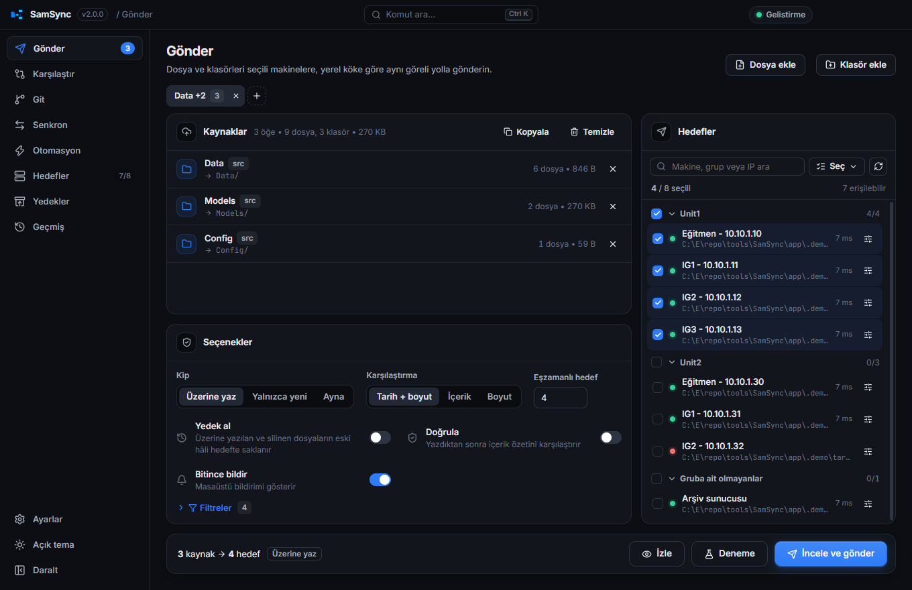
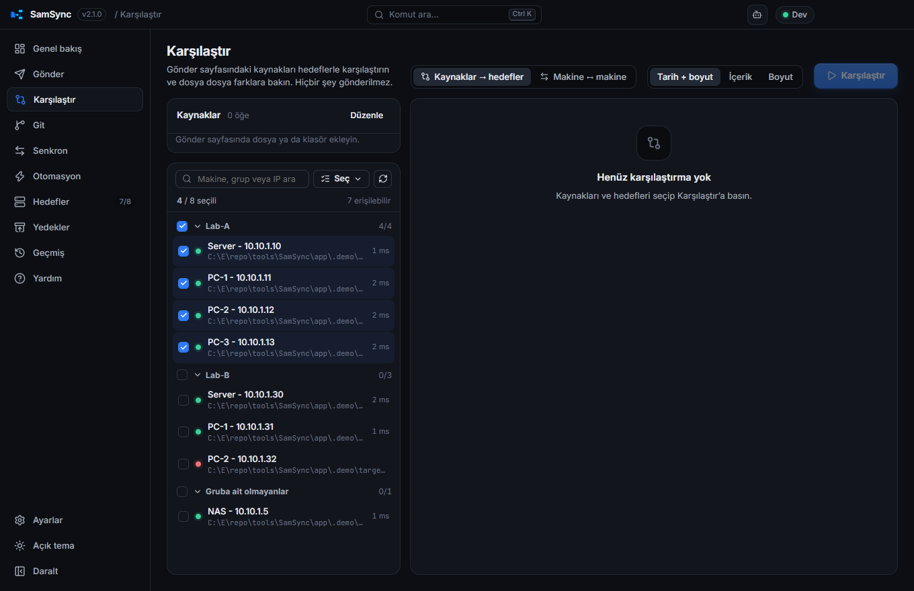
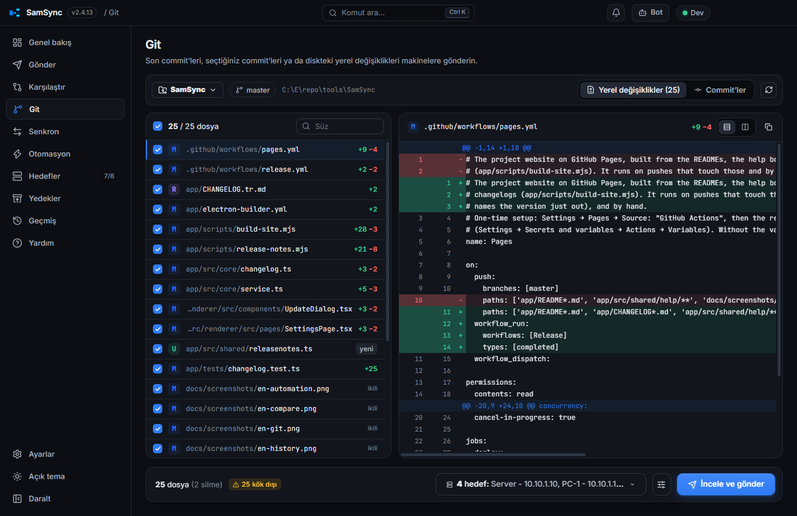
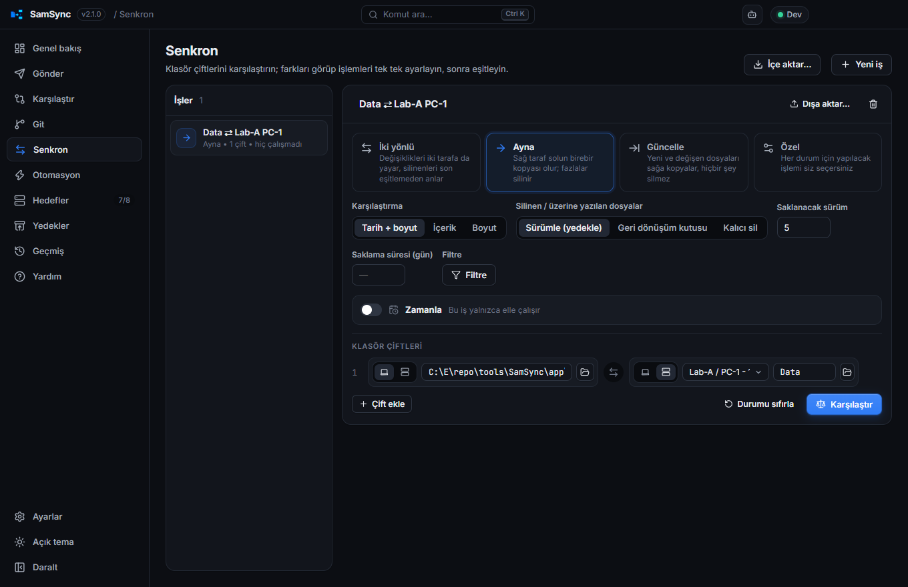
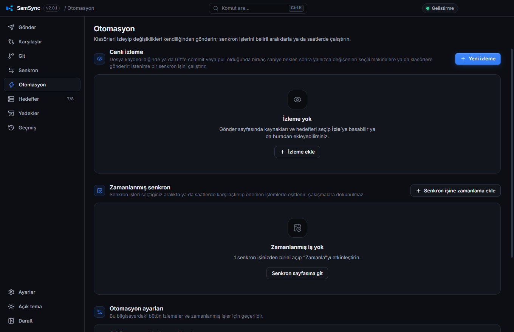
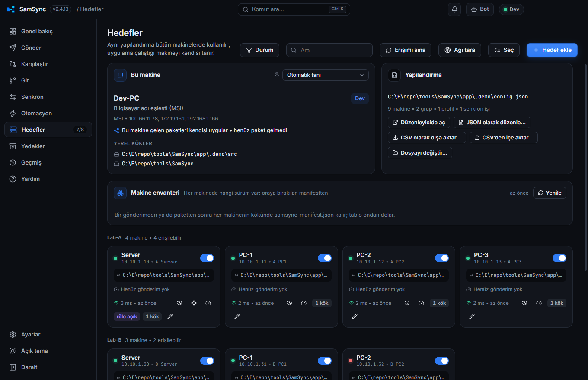
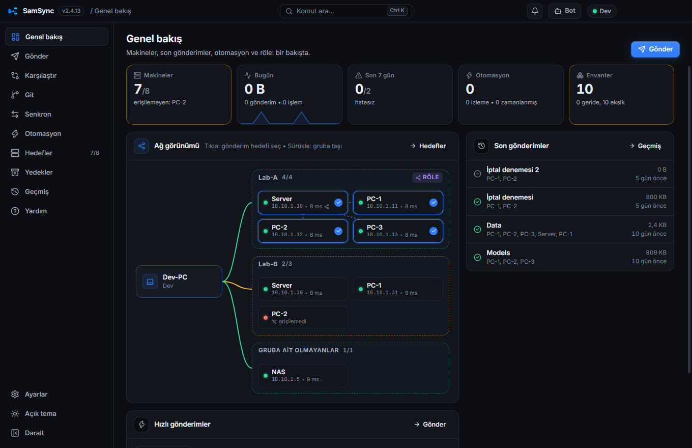
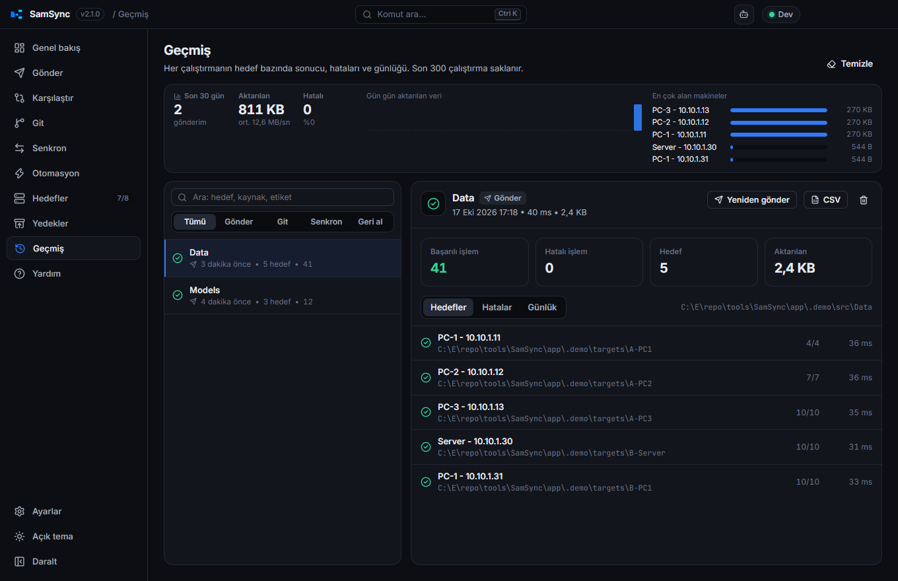

# SamSync

[English](README.md)

Dosyaları, klasörleri ve Git değişikliklerini birden çok makineye **aynı göreli yolla** gönderen; hedefleri karşılaştıran, eşitleyen, değişiklikleri kendiliğinden gönderen ve gerektiğinde eski hâline döndüren masaüstü uygulaması. Windows, macOS ve Linux'ta çalışır (Electron + React + TypeScript).

Eski PowerShell aracının ([`../legacy`](../legacy/README.tr.md)) yerini alır ve onun `config.json` dosyasını olduğu gibi okur.

Arayüz Türkçe ve İngilizcedir. Ayarlar → **Dil** altında bir dil seçilmedikçe bilgisayarın görüntü dilini izler: Türkçe Windows'ta Türkçe, diğerlerinde İngilizce.

## Ekran görüntüleri

| | |
| --- | --- |
|  |  |
|  |  |
|  |  |
|  |  |

## Kurulum

`npm run dist:win` üç dosya üretir (`release/<sürüm>/`):

| Dosya | Ne zaman |
| --- | --- |
| `SamSync-Setup-<sürüm>.exe` | Önerilen. Kullanıcı başına kurulur (yönetici yetkisi gerekmez), Başlat menüsü ve masaüstü kısayolu oluşturur, **otomatik güncellenir**. |
| `SamSync-<sürüm>-portable.exe` | Kurulumsuz, tek dosya. USB'den ya da paylaşımdan çalıştırılabilir. Her açılışta kendini yeniden açar ve kendini güncelleyemez. |
| `SamSync-<sürüm>-win.zip` | Kurulumsuz, açılmış uygulama: istediğiniz yere çıkarıp `SamSync.exe`'yi çalıştırın. Tek dosyalı sürümden hızlı açılır, kendini güncelleyemez. |

İki taşınabilir biçim de ayarlarını, geçmişini ve günlüğünü programın yanındaki `SamSync-data` klasöründe tutar; böylece programla birlikte taşınır ve sonraki açılışta yerinde olur. Bu klasöre yazılamıyorsa (salt okunur paylaşım) kurulu uygulamanın kullanıcı klasörü kullanılır.

macOS (`.dmg`) ve Linux (`.AppImage`) paketleri kendi işletim sistemlerinde üretilir; GitHub Actions bunu üçü için birden yapar (aşağıda *Sürüm yayınlama*).

## İlk açılış

Yapılandırma yoksa karşılama ekranı üç yol sunar:

- **Mevcut config.json'ı kullan** — ağ paylaşımındaki ortak dosya ya da eski aracın `legacy/config.json` dosyası. Uygulama değişiklikleri o dosyaya yazar; eski aracın alanları (`version`, `menuTitle`, `notepadPlusPlusShortcuts`…) korunur, PowerShell aracı aynı dosyayla çalışmaya devam eder.
- **Kopyasını içe aktar** — makineleri bu bilgisayarın kendi yapılandırmasına kopyalar.
- **Sıfırdan başla** — makineleri Hedefler sayfasından tek tek ekleyin.

Uygulama çalıştığı makineyi eski araçla aynı kurallarla tanır: `SAMSYNC_NODE_ID` ortam değişkeni, IP adresi, bilgisayar adı (`address` / `localNames`; yalın ad ya da etki alanında `<ad>.<USERDNSDOMAIN>`), birden çok eşleşmede yerel kökün varlığı. Hedefler sayfasından makine elle de sabitlenebilir.

Node kimlikleri ve grup adları yalnızca harf, rakam, nokta, alt çizgi ve tire içerebilir (`Unit1`; boşluk yok). Çünkü komut satırlarında ve menülerde makine kimliği ve `group:<ad>` olarak kullanılırlar. Eski araçtaki gibi, bu kurala uymayan bir yapılandırma yüklenmez.

## Sayfalar

### Genel bakış
İlk sayfa (Ctrl 1): kutularda makineler (erişilen / toplam, erişilemeyenler), bugün aktarılan veri ve 14 günlük küçük grafik, haftanın hatalı gönderimleri, otomasyon, envanter ve varsa röle ile bekleyen güncelleme; altında son gönderimler, hızlı gönderimler, izlemeler ve zamanlanmış işler. **Ağ görünümü** bu bilgisayarı solda, grupları sağda çizer: her gruba giden çizgi kaç makinesinin yanıt verdiğine göre renkli, röle işaretli ve dağıttığı makinelere kesikli çizgiler. Bir makineye tıklamak onu gönderim hedefi yapar, başka bir grubun kutusuna sürüklemek grubunu değiştirir.

### Gönder
Dosya/klasörleri pencereye sürükleyin, seçin ya da yolu yapıştırın; hedefleri seçin (gruplar, arama, erişim noktası, profiller, “son çalıştırmada hatalılar”). **İncele ve gönder** her hedefte ne olacağını dosya dosya gösterir:

| İşaret | Anlamı |
| --- | --- |
| `+` | hedefte yok, yeni |
| `~` | güncellenecek |
| `!` | hedefteki dosya **daha yeni** (Üzerine yaz kipinde yazılır, Yalnızca yeni kipinde atlanır) |
| `−` | hedefte fazla (yalnızca Ayna kipinde silinir) / Git'te silinmiş |

Gönderimden sonra hedefin kökünde `samsync-manifest.json` da durur: gönderilen klasörün altındaki her şey (ad, boyut, tarih), SamSync'in bıraktığı hâliyle. Sonraki plan hedefi ağ üzerinden gezmek yerine ondan başlar — önce kökün listesi ve 24 dosyalık bir örnek hedefle karşılaştırılır; biri bile tutmazsa (diskten kopyalanmış bir sürüm gibi) klasör eskisi gibi taranır. 7 günden eski manifest kullanılmaz; incelemede "manifestten" rozeti görünür; Karşılaştır sayfası her zaman doğrudan bakar. Gönderim bir makineye yazarken kökte `samsync-lock.json` bırakır (bilgisayar, kullanıcı, gönderimin adı, başlangıç); başkasının taze kilidi incelemede o makinede "X yazıyor" uyarısıyla görünür, çalıştırma günlüğüne de düşer (gönderim yine sürer). 30 dakikadan eski kilit yok sayılır. Liste varsayılan olarak **klasör ağacı** (her klasör satırında dalın sayıları ve boyutu, tek çocuklu zincirler tek satırda, ilk düzey açık; klasörün onay kutusu bütün dalı alır) ya da istenirse düz liste. Her satırın işareti kaldırılabilir, `⇄` ile kaynak–hedef satır farkı açılır, **Seçimi tüm hedeflere uygula** bir hedefte yapılan seçimi ötekilere taşır. **İzle** seçili kaynakları izlemeye alır (bkz. *Otomasyon*).

Seçenekler: kip (Üzerine yaz / Yalnızca yeni / Ayna), karşılaştırma (tarih+boyut / içerik / boyut), **yedek al** (eski hâller hedefte yedek klasörüne `<tarih>` altında taşınır), doğrulama (içerik özeti), hariç dosya/klasör kalıpları, eşzamanlı hedef sayısı, deneme çalıştırması, bitince bildirim, kopyalama sonrası komut.

**Hedefe özel ayar** (eski sihirbazın *Yedek al* / *Yalnızca yeni* / *Ayna* sütunları): makine satırının sonundaki ayar düğmesi o makineye kendi kipini ve yedeğini verir. Örneğin eğitmen yedekli aynalanırken IG'ler yalnızca yeni dosyaları alabilir.
- Satır istisnayı rozetle gösterir, alt çubuk sayar (*N hedefte özel ayar*), inceleme de her hedef kartında gösterir.
- **Seç → Hedefe özel ayarları temizle** bütün makineleri genel seçeneklere döndürür.
- Son gönderimle birlikte saklanır; `--to last` ve *Son ayarla gönder* bunları kullanır. Profil kendi makinelerinin istisnalarını saklar.

**Sekmeler.** Gönder sayfasında her biri kendi kaynaklarını ve hedeflerini tutan sekmeler var (**+** yeni sekme açar, çift tık yeniden adlandırır). Explorer'dan ya da Notepad++'tan gelen *İncele ve gönder* kendi sekmesinde açılır; menüden gelen öğeler elle hazırladığınız listeye hiç karışmaz.

Yazma atomiktir: dosya önce geçici adla yazılır, boyutu (ve istenirse özeti) doğrulanır, sonra yerine konur. Yarım kalan kopya hedefi bozmaz. 8 MB ve üstü dosyalar sabit adlı bir geçici dosyaya yazılır; iptal, kopan bağlantı ya da kapanan uygulama yüzünden yarım kalan kopya bir sonraki gönderimde **kaldığı yerden sürer** (önce hedefteki parçanın kuyruğu kaynakla karşılaştırılır). İptal artık dosyanın bitmesini beklemez, kopyayı anında keser.

**Paket dosyası.** **Paket yaz**, kaynakları (gönderimin dışlamaları ve ignore dosyalarıyla) makineler yerine tek bir sıkıştırılmış `.samsync-pack` dosyasına yazar — USB ile götürülen sürüm için. Alan makinede dosya Gönder listesine bir klasör gibi eklenir: plan içindekileri hedefle karşılaştırır, yalnızca farklı olanlar yazılır, ayna fazlalıkları siler, bitince ağ gönderimindeki gibi manifest kalır; sonraki ağ gönderimi yine hızlı başlar. Bütün kaynaklar paketse **bu makine** de hedef olabilir (kendi diskine, doğrudan). Kaynak satırında "paket" rozeti: etiket, dosya sayısı, boyut, kim yaptı, ne zaman.

### Karşılaştır
Gönder sayfasındaki kaynakları hedeflerle **hiçbir şey göndermeden** karşılaştırır. Her hedefin sayılarıyla bir sekmesi olur. Soldaki listede yeni, değişen, hedefte daha yeni ve fazla dosyalar süzgeç ve aramayla görünür; seçtiğiniz dosyanın satır farkı, Git sayfasındaki gibi sağda açılır. **Bu farkları gönder…** her zamanki incelemeyi açar.

**Makine ↔ makine** kipi aynı klasörü iki makinede karşılaştırır: yalnız birinde olanlar, farklı olanlar, hangisinin daha yeni olduğu ve seçilen dosyanın satır farkı — aynı olması gereken simülatörler (IG1 ↔ IG2) için. Hiçbir şey yazılmaz; eşitlemek için Senkron sayfası.

### Git
Depo, yerel köklerden otomatik bulunur (ya da eklenir).

- **Yerel değişiklikler** — hazırlanmış, hazırlanmamış ve izlenmeyen dosyalar.
- **Commit'ler** — tıkla: tek commit; Ctrl+tıkla: ekle/çıkar; Shift+tıkla: aralık. Hızlı seçimler: *Son commit*, *Son 3*, *Push edilmemiş*. Mesaj veya SHA ile arama, tüm dallar.

Seçilen commit'lerin dosyaları tek listede birleşir; her dosyanın farkı sağda görünür. İçerik kaynağı seçilebilir: **diskteki hâli** ya da **commit'teki hâli**. Silinen ve taşınan dosyalar hedeften de kaldırılır (kapatılabilir). Commit içeriği hedefle git nesne özeti üzerinden karşılaştırıldığı için aynı olan dosya yeniden yazılmaz.

### Senkron
Klasör çiftleri (sol: bu makine ya da bir hedef, sağ: herhangi bir hedefin alt klasörü ya da yerel klasör) için:

- **İki yönlü** — son eşitlemenin durumunu hatırlar; bir tarafta silineni öbür tarafta da siler, iki tarafta değişeni **çakışma** olarak işaretler.
- **Ayna**, **Güncelle**, **Özel** (her durum için işlemi siz seçersiniz).
- Filtre: dahil/hariç kalıpları, boyut ve tarih sınırı. İki taraftan birinin kökündeki (ya da Gönder sayfasından gönderilen bir klasördeki) **`.samsyncignore`** dosyası kendi desenlerini ekler: satır başına bir desen, `#` açıklama, sonda `/` klasör demektir. Dosyanın kendisi hiç kopyalanmaz.
- Silinen ya da üzerine yazılan dosyalar üç yoldan birine gider:
  - **sürüm klasörüne**: sayıyla ve istenirse gün olarak yaşla sınırlanır;
  - **Geri Dönüşüm Kutusu'na**: yerel klasörlerde; diğer yerlerde sürüm klasörü kullanılır;
  - ya da kalıcı olarak silinir.
- **Dışa aktar / İçe aktar**, bir işi `.samsync-job.json` dosyası olarak kaydeder ve bu ya da başka bir makinede geri yükler.
- `SamSync.exe --sync <iş>`, bir işi pencere açmadan çalıştırır (ör. Windows Görev Zamanlayıcı'dan). Bir özet yazar ve her şey başarılıysa `0` ile çıkar.
- **Zamanla** — iş belirli aralıklarla ya da saatlerde kendiliğinden çalışır (bkz. *Otomasyon*).

Karşılaştırma sonucu ızgarada görünür; her satırın işlemi tıklanarak değiştirilir, çift tıklama satır farkını açar.

### Otomasyon
- **Canlı izleme** — bir değişiklikten sonra kısa bir sessizlik süresi (varsayılan 2 sn) bekler ve yalnızca değişenleri gönderir. Gönder sayfasındaki **İzle** düğmesiyle ya da bu sayfadan eklenir.
  - *Ne zaman:* dosya kaydedilince ya da **Git olaylarında**. Commit, amend, merge ya da pull'dan sonra (isteğe bağlı olarak rebase, cherry-pick, reset de) o commit'lerin değiştirdiği dosyalar diskteki hâlleriyle gönderilir. Deponun reflog'u okunduğu için Git kancası gerekmez; dal değiştirmek, siz istemedikçe bir şey göndermez.
  - *Nereye:* yapılandırmadaki makinelere ve/veya yapılandırma gerektirmeyen **düz klasörlere** (yerel, bağlı ya da `\\sunucu\paylaşım`). İzlenen her klasörün içeriği, kendi içindeki yollarıyla oraya yazılır. Göndermek yerine her değişiklikte **bir senkron işi de çalıştırılabilir** (canlı iki yönlü, ayna… senkron).
  - *Elle:* izleme kartındaki gönder düğmesi, izlenen yollarda hedeften farklı olanları beklemeden gönderir; izleme kapalıyken de çalışır. Senkron işi çalıştıran izlemede işi çalıştırır. Yalnızca farklar gider, hedefte bir şey silinmez.
  - *Ayrıca:* izleme başlarken mevcut farklar bir kez gönderilebilir. Geçici dosyalar (`~$…`, `.tmp`, `.swp`) ve `.git` yok sayılır; hedefte silme isteğe bağlıdır.
- **Zamanlanmış senkron** — senkron işleri her N dakikada bir ya da belirli saatlerde (örn. 09:00, 18:30) karşılaştırılıp önerilen işlemlerle eşitlenir; çakışmalara dokunulmaz. Yapılandırma bütün makinelerde ortak olduğu için her iş **tek bir makinede** çalışacak şekilde işaretlenir. Uygulama kapalıyken kaçırılan saat, açılınca çalıştırılır.
- **Zamanlanmış hızlı gönderim** — Gönder sayfasında kaydedilmiş bir hızlı gönderim belirli saatlerde ya da her N dakikada bir bu makinede kendi kendine gider, inceleme açılmadan (değişiklik yoksa bir şey olmaz). Çipteki kalem adı, kısayolu ve zamanlamayı düzenler; burada zamanlanmış işlerle birlikte listelenir, *Şimdi çalıştır* var.
- **Hepsini duraklat** — izleme ve zamanlamayı birlikte durdurur (tepsi menüsünden de).
- **Otomasyon ayarları** (bilgisayar başına):
  - erişilemeyen makinelere yeniden deneme: varsayılan olarak kapalı. Kapalıyken erişilemeyen makine o değişiklikleri almaz; açıkken değişiklikler saklanır ve N dakikada bir yeniden gönderilir;
  - bildirimler: hiç / yalnızca hatalarda / her gönderimde;
  - tek bir otomatik gönderimin en çok kaç dosya taşıyacağı (binlerce değişiklik gibi görünen bir dal değişikliği gönderilmez; varsayılan 1000, 0 = sınırsız);
  - uygulama kapalıyken kaçırılan zamanlamanın açılışta çalışıp çalışmayacağı.

Otomasyon uygulama açıkken çalışır. Ayarlar → *Arka plan ve başlangıç*: **Kapatınca sistem tepsisinde çalışmaya devam et** ve **Windows açılışında başlat** (tepside gizli başlar) ile sürekli çalışabilir. Otomatik çalışmalar da Geçmiş'e yazılır.

### Hedefler, Yedekler, Geçmiş, Ayarlar
- **Röle** — bir gruptaki bir makine kartında grubun rölesi olarak işaretlenebilir. Röleyle birlikte grubun başka makinelerini de içeren bir gönderim yalnızca röleye yazar (kendi, çoğu zaman yavaş, bağlantınızdan — örn. Wi‑Fi — tek kopya); röledeki SamSync işi paylaşımındaki `_SamSyncRelay\jobs` klasöründen alır, dosyaları kendi diskinden grubun ağı üzerinden dağıtır ve sonucu yazar; inceleme, çalıştırma paneli ve geçmiş her makineyi "X üzerinden" olarak sonucuyla gösterir. Rölenin kendi değişiklikleri dosya dosya ağ kopyası yerine **tek bir sıkıştırılmış paket** olarak gider (`_SamSyncRelay\jobs\<id>.pack`, dosya başına gzip; zaten sıkışık biçimler olduğu gibi); oradaki SamSync paketi diskine uygular (yedek, kullanımdaki dosya denetimi ve doğrulama her zamanki gibi), sonra dağıtır. Bir DLL yaklaşık %40'a, bir PDB %23'e iner. Röle olarak işaretlenen makine, arkasında kimse olmasa da değişikliklerini paket olarak alır. Röledeki SamSync yarım dakikada bir kalp atışı yazar (`_SamSyncRelay\alive.json`): makine kartındaki rozet **röle açık / röle kapalı** der; kalp atışı eski ya da yoksa plan röleye ve arkasındakilere beklemeden doğrudan yazar. Kalp atışı taze olduğu hâlde röle 60 sn içinde işi almazsa paket geri alınır ve o makinelere, röle dahil, buradan doğrudan ayrı bir gönderim başlar. Tek başına seçilen bir grup makinesine doğrudan yazılır; Karşılaştır sayfası ve `--check-only` her makineye doğrudan bakar. Rölenin ilk yerel kökü paylaşımının gösterdiği klasör olmalıdır; `copy.relayAckSeconds` ve `copy.relayTimeoutMinutes` bekleme sürelerini ayarlar.
- **Makine envanteri** — Hedefler sayfasında hangi makinede hangi sürüm olduğu: satırlar gönderilen klasörler, sütunlar makineler; hücrede SamSync'in bıraktığı manifestten etiket, zaman ve boyut. Bir klasörün en yeni hâli ölçüttür; ondan geride olanlar "geride", klasörü hiç almamış olanlar "eksik", erişilemeyen makine kırmızı. Her çalıştırmadan sonra ve istenince yenilenir; paketten uygulanan sürümler de burada görünür.
- **Hedefler** — makine kartlarında erişim durumu (45 sn'de bir yenilenir), son gönderimin hızı ve süresi, **hız sınaması** (3 MB yazılır, geri okunur, silinir: yazma/okuma MB/sn ve gecikme) ve rölede SamSync'in çalışıp çalışmadığı; "Bu makine" kartı rölenin kendi durumunu gösterir (alınan iş, son iş). Ekleme/düzenleme. **JSON olarak düzenle** bütün yapılandırma dosyasını metin olarak açar:
  - siz yazarken denetler ve hatanın satırını ve sütununu gösterir; kaydederken yapılandırma olarak bir kez daha denetler;
  - metni yazdığınız gibi kaydeder, eski aracın alanları korunur;
  - başka bir dosyayı gözden geçirmek için düzenleyiciye yükleyebilir ve bir kopyasını dışa aktarabilir. Bağlantı türleri: Windows paylaşımı (SMB, `\\adres\networkRoot`), klasör/bağlı sürücü, **SFTP** (anahtar, agent ya da işletim sisteminin şifreli deposunda saklanan parola).
- **Yedekler** — bir öğenin hedeflerdeki yedeklerini bulur, tarih seçip geri yazar (önce şu anki hâli yedekleyerek). Hedef kökündeki eski yedek klasörleri de taranır (aşağıya bakın); onların sürümlerinde klasör adı görünür.
- **Geçmiş** — son 300 çalıştırma: hedef bazında sonuç, hatalar, günlük, CSV rapor, *yeniden gönder* / *hatalılara yeniden gönder*. Üstteki şerit son 30 günü gösterir: gönderim sayısı, veri ve ortalama hız, hatalılar, gün gün çubuk (hatalı gün kırmızı; tıklayınca o gün listelenir) ve en çok veri alan makineler. **Geri al**, yedek alınarak yapılmış bir gönderimin değiştirdiği ve sildiği dosyaları o çalıştırmanın yedeklerinden geri getirir, eklediklerini siler. Çalıştırma günlüğü çalışırken `history/<id>.log` dosyasına akar. Gönderim sürerken çalıştırma paneli son bir dakikanın hız grafiğini (anlık, tepe, ortalama, duraklama), grup çiplerini ("Unit1 3/5") çizer; Windows görev çubuğundaki düğme ilerlemeyle dolar ve arkada biten gönderimde yanıp söner.
- **Ayarlar** — dil (Sistemle eşle / Türkçe / English; varsayılan sistemle eşle), tema (Koyu / Açık / Sistemle eşle; varsayılan koyu), vurgu rengi, yoğunluk; kopyalama varsayılanları (yeniden deneme, eşzamanlılık, **hedef başına bant genişliği sınırı** — eski aracın `/IPG` karşılığı, yedek klasörü adı); yapılandırma dosyası; sağ tık menüleri (Explorer, Notepad++); arka plan ve başlangıç; güncellemeler (sürüm notları bağlantısıyla); **Tanılama klasörü oluştur…** (günlükler, yapılandırma, ayarlar ve bir özet tek klasörde, parolalar hariç; bir sorunu anlatırken paylaşın); **Bildirimler** (gönderim bitince JSON alan bir web kancası ve/veya mesaj alan bir Telegram botu ve sohbeti — hatada her zaman, başarıda isteğe bağlı — başarısız makineler nedenleriyle; sınama düğmesi); **arayüz ölçeği** (%70–175; Ctrl + / Ctrl − / Ctrl 0 ile de); **Bu sürümdeki yenilikler** (güncellemeden sonra bir kez gösterilen sürüm notu). Pencerenin boyutu, yeri ve ekranı kaplama durumu bir sonraki açılışta geri gelir. Arayüz bir hata verirse boş pencere yerine hatanın metni, *Yeniden yükle*, tanı klasörü ve kopyalama düğmeleri çıkar.

**Klavye:** Ctrl K komut paleti, Ctrl / bütün kısayolların listesi, Ctrl , Ayarlar, Ctrl 1…9 sayfalar (Genel bakış 1), Ctrl Enter Gönder sayfasında inceleme açar ve incelemede gönderir (Shift ile deneme), Esc açık olanı kapatır.

Yedek klasörü varsayılan olarak hedef kökündeki `_SamSyncYedek` klasörüdür; adı Ayarlar → Kopyalama’dan değiştirilebilir.

**Eski yedek klasörleri** — eski araç yedeklerini hedef kökünde kendi adını taşıyan bir `_…Yedek` klasöründe tutuyordu. SamSync bir klasörü şu durumda yedek klasörü sayar: hedefin (ya da bir yerel kökün) kökündedir, adı `_` ile başlar ve içinde yalnızca `yyyyMMdd-HHmmss` klasörleri vardır. Böyle bir klasör:
- kökün tamamı ayna kipinde gönderilirken ya da aynalanırken silinmez, içine yazılmaz (inceleme bunu söyler) ve gönderime katılmaz;
- Yedekler sayfasında görünür, sürümleri geri alınabilir;
- hiç temizlenmez: *Saklanacak yedek* sayısı yalnızca ayarlı klasöre uygulanır.

Adı değiştirilmiş eski bir SamSync yedek klasörü de aynı biçimde ele alınır.

**Eski sihirbazdan içe aktarma** — Ayarlar → *Yapılandırma dosyası* → **Sihirbaz ayarlarını içe aktar**, eski sihirbazın profillerini ve son seçimini bir kez taşır.
- **Dosya:** `%LOCALAPPDATA%` altındaki `wizard-state.json` kendiliğinden bulunur; *Dosya seç…* ile elle de seçilebilir. Bu yapılandırma için kaydedilmiş kayıt kullanılır; klasör o zamandan beri taşındıysa makinelerinin çoğunu tanıyan kayıt alınır.
- **Son seçim:** işaretli makineler son gönderimin hedefleri olur. Makine başına sütunlar genel seçeneklere ve hedefe özel istisnalara dönüşür; böylece her makine eskiden neyse aynısını alır. Sihirbazın hariç dosya ve klasörleri yapılandırmadakilere eklenir. Deneme çalıştırması ve yalnızca robocopy'ye özgü ayarlar (hızlı kopyalama, paket arası bekleme, yeniden deneme) alınmaz.
- **Profiller:** yapılandırmaya SamSync profili olarak eklenir. Aynı adlı bir profil varsa olduğu gibi kalır.
- **Bilinmeyen makineler:** yapılandırmada olmayan makineler atlanır ve listelenir.

Eski araçta makine kimliği `setx` ile sabitlenmiş bilgisayarlarda aynı değeri `SAMSYNC_NODE_ID` olarak tanımlayın (`setx SAMSYNC_NODE_ID Unit1Trainer`) ya da Hedefler → *Bu makine*’den seçin.

## Explorer ve Notepad++ menüleri

Kurulu uygulama eski aracın sağ tık menülerini geri getirir ve bu menüler **varsayılan olarak açıktır**. Ayarlar → **Sağ tık menüleri** altından kapatılabilirler. Uygulama her açılışta ve makine listesi, dil ya da bu anahtarlar değiştiğinde menüleri yeniden kurar. Menüler her zaman çalışan programı gösterir, bu yüzden güncelleme ya da taşıma sonrasında da çalışmaya devam ederler. Kaldırıcı menüleri siler.

**Explorer**'da dosya ve klasörlere sağ tıklayınca, eskisiyle aynı yapıda bir **SamSync** alt menüsü çıkar. Windows 11'de bu menü “Daha fazla seçenek göster” altındadır.

| Girdi | Tıklayınca |
| --- | --- |
| Tümüne gönder | bu makine dışındaki bütün etkin makinelere hemen gönderir |
| İncele ve gönder… | SamSync'i öğeler Gönder sayfasında olacak şekilde açar |
| Son ayarla gönder | son incelenen gönderimin hedefleri ve seçenekleriyle hemen gönderir |
| Yedekten geri al… | Yedekler sayfasını öğelerle açar ve bütün makinelerde arar |
| <profil> (profil) | profilin hedefleri ve seçenekleriyle hemen gönderir |
| <grup> | bütün gruba hemen gönderir ya da “<grup> - Tümü” ve makinelerini içeren bir alt menü açar |
| <makine> | o makineye hemen gönderir (gruba ait olmayan makineler) |

- **Ayırıcılar** menüyü bölümlere ayırır: tümü | incele ve son ayar | geri al | profiller | gruplar | tek makineler.
- **Menünün sığması:** Windows sabit bir alt menüyü 16 girdiye kadar rahat gösterir. Önce bu makinenin kendi grubu açılır. Diğer gruplar ancak hepsi birlikte sığarsa açılır; sığmazsa her biri tek girdi olur. Bu davranış eski araçtaki gibi `config.json` içindeki `menuShowNodes` ile değiştirilebilir (`auto`, `always`, `never`); aynı ayar Ayarlar sayfasında da var.
- **Tek tıkla gönderimler** Gönder sayfasındaki listeye dokunmaz. Hedefte silme yapacak bir gönderim (profilden ya da son ayardan gelen ayna kipi) doğrudan gönderilmez, inceleme açılır.
- **Menünün başlattığı program:** `SamSync.exe`'nin yanındaki küçük `SamSyncSend.exe` (kurulum ve zip sürümlerinde). Komut satırını çalışan SamSync'e adlandırılmış boru üzerinden birkaç milisaniyede verir; uygulama çalışmıyorsa `SamSync.exe`'yi başlatır. Tek dosyalı taşınabilir sürümün böyle bir komşusu yoktur, kendisini başlatır; ikinci bir `SamSync.exe` de çalışanı bulup ağır hiçbir şey yüklemeden çıkar.
- **Büyük seçimler:** 100 öğeye kadar seçim desteklenir. Explorer her öğe için programı bir kez başlatır ve gelen istekler tek gönderimde birleşir. Birleştirme boru üzerinden 150 ms (ikinci bir süreçle 400 ms) sessizlik bekler; ikinci öğe gelince bu süre 0,4 / 1,2 sn olur, en çok 30 sn sürer.

**Notepad++**'ta (8.4.8 ve üzeri; standart kurulum ya da `doLocalConf.xml` ile taşınabilir kurulum):
- **Sekme menüsü:** sekmeye sağ tıklayınca bir **SamSync** klasörü çıkar. Klasörde aynı girdiler düz bir liste hâlinde durur; her bölümün ve her grubun arasında bir ayırıcı vardır.
- **Çalıştır menüsü:** aynı girdiler Çalıştır komutları olarak da eklenir.
- **Kısayollar:** `config.json` içindeki `notepadPlusPlusShortcuts` alanından gelir, örneğin `{ "wizard:last": "Ctrl+Alt+W" }`; bu aynı zamanda varsayılandır. `Ctrl+Alt+W`, etkin sekmedeki kaydedilmiş dosyayı pencere açmadan son ayarla gönderir. Girdi kimlikleri eskileriyle aynıdır: `all`, `wizard`, `wizard:last`, `restore`, `profile:<ad>`, `group:<ad>` ve makine kimlikleri. Kısayollar Ayarlar'dan da düzenlenebilir.
- **Dosyalarda ne değişir:** SamSync `shortcuts.xml` ve `tabContextMenu.xml` dosyalarını metin olarak düzenler ve yalnızca adı `[SamSync] …` olan girdilere dokunur. Ardından `shortcuts.xml` dosyasını `config.xml` içinde imzalar (`shortcutsXmlHMAC`; Notepad++ 8.9.6.2'den beri gerekli).
- **Notepad++ açıksa:** Notepad++ kapanırken bu dosyaları kendi belleğindeki hâliyle yeniden yazar, bu yüzden açıkken yapılan değişiklikler kaybolur. SamSync, Notepad++ kapandıktan sonra dosyaları yeniden yazar.
- **Çok uzun komutlar:** 260 karakteri (Notepad++ sınırı) aşan bir komut uyarıyla atlanır.

Eski aracın menüleri hâlâ duran bir makinede onları `legacy\Uninstall-ContextMenu.bat` ile kaldırın; yoksa iki menü birden görünür.

## Komut satırı

```bat
SamSync.exe "C:\Sim\ActiveRelease\Data\x.entity" "C:\Sim\ActiveRelease\Models"
SamSync.exe --to group:Unit1,Arsiv "C:\...\Data"
SamSync.exe --to last --yes "C:\...\Data\x.entity"
SamSync.exe --quick "DLL → Dozer"
```

`--quick <ad>`, Gönder sayfasında kaydedilen bir **hızlı gönderimi** (bir ad altında kaynaklar, hedefler ve seçenekler) çalıştırır; aynı gönderimler tepsi menüsünde ve komut paletinde de durur, istenirse sistem geneli bir kısayol tuşu alır (örn. `Ctrl+Alt+1`; uygulama tepsideyken de çalışır). "Önce incele" ile kaydedilen bir hızlı gönderim inceleme açar.

| Argüman | Anlamı |
| --- | --- |
| yollar | Gönder listesine eklenir |
| `--to <kimlikler>` | virgülle ayrılmış makine kimlikleri, `group:<ad>`, `profile:<ad>`, `all` ya da `last` (son incelenen gönderimin hedefleri ve seçenekleri); incelemeyi açar |
| `--yes` | `--to` ile birlikte kullanılır: incelemeden hemen gönderir (menü girdileri bunu kullanır) |
| `--restore` | Yedekler sayfasını öğelerle açar |
| `--hidden` | tepside başlar (açılışta başlatma bunu kullanır) |
| `--remove-integrations` | Explorer menüsünü ve Notepad++ girdilerini kaldırıp çıkar (kaldırıcı bunu kullanır) |
| `--plan-only` | her öğenin her hedefte nereye gideceğini pencere açmadan yazar (eski `-PlanOnly`) |
| `--check-only` | her hedefte öğelerin aynı olup olmadığını pencere açmadan yazar (eski `-CheckOnly`) |

Kısayollar: `Ctrl+K` komut paleti, `Ctrl+/` bütün kısayollar, `Ctrl+,` Ayarlar, `Ctrl+1…9` sayfalar, `Ctrl+Enter` incele / gönder, `Ctrl` `+`/`−`/`0` arayüz ölçeği, `F12` geliştirici araçları.

### Pencere açmadan plan ve eşitlik denetimi

```bat
start /wait SamSync.exe --check-only --to all "C:\Sim\ActiveRelease\Data"
echo %ERRORLEVEL%
SamSync.exe --plan-only --to profile:Unit1IG "C:\Sim\ActiveRelease\Data\x.entity" | more
```

İki kip de uygulamayla aynı ayarları ve yapılandırmayı kullanır; SamSync penceresi açıkken de çalışır. `--to` gönderimdeki gibidir: verilmezse bütün hedefler; `last` ve `profile:` kendi hedefe özel ayarlarını da getirir. Tablo standart çıktıya, makine bilgisi, uyarılar, hatalar ve özet standart hataya yazılır; böylece tablo tek başına yönlendirilebilir. Sütun adları ve durum değerleri ASCII'dir ve eski araçtakilerle aynıdır:

- `--plan-only` — her öğe ve hedef için bir satır: `Source`, `LocalRoot`, `LocalMachine`, `Target`, `Destination`, `Options` (`Backup`, `OnlyNewer`, `Mirror`). Hedeflerde hiçbir şey okunmaz.
- `--check-only` — her hedef için bir satır: `Target`, `TargetId`, `State`, `Changes`, `Missing`, `DestNewer`, `Extras`. Hiçbir şey yazılmaz. `State` şunlardan biridir:
  - `Ayni` — aynı;
  - `Farkli` — farklı;
  - `Yok` — öğelerin hiçbiri hedefte yok;
  - `Erisilemedi` — erişilemedi;
  - `Hata` — hedef okunurken hata oluştu.

  Hedefte yalnızca fazladan dosya olması onu farklı yapmaz.

Çıkış kodu: `0`, planın hesaplandığı ya da bütün hedeflerin aynı olduğu anlamına gelir. `1`; fark, eksik öğe, erişilemeyen hedef ya da hata (kaynak yok, hedef bilinmiyor, bu makine tanınmadı, yapılandırma okunamadı) demektir. Sonuç `root.log`'a da yazılır.

SamSync.exe bir Windows pencere programı olduğu için `cmd` onu kendiliğinden beklemez. `%ERRORLEVEL%` için `start /wait` kullanın ya da çıktıyı bir boruya verin (`| more`; PowerShell'de `| Out-String`); böylece kabuk bekler ve `$LASTEXITCODE` dolar.

## Otomatik güncelleme

Ayarlar → Güncellemeler (kaynak paylaşılan yapılandırmada durur):

| Kaynak | Kullanım |
| --- | --- |
| GitHub | Sürüm GitHub Releases'tan gelir (aşağıdaki iş akışı ya da `npm run release:github`, `GH_TOKEN` gerekir). |
| Web adresi | `latest.yml` ve kurulum dosyalarının durduğu herhangi bir HTTP(S) klasörü. |
| Ağ klasörü | İnternete çıkmayan makineler için: `npm run release:folder -- "\\sunucu\Dagitim\SamSync"`. Makineler `latest.yml`'i okuyup kurulumu SHA-512 ile doğrular ve sessizce kurar. |

Açılışta ve 6 saatte bir denetlenir, yeni sürüm arka planda indirilir; “Yeniden başlat ve kur” ile kurulur. Sürüm numarası `package.json` içindeki `version` alanıdır. macOS'ta otomatik güncelleme imzalı paket gerektirir.

GitHub deposunun adı kodda yazılı değildir: `scripts/dist.mjs` derleme sırasında onu git uzak adresinden (CI'da `GITHUB_REPOSITORY`) okur, electron-builder pakete yazar.

## Sürüm yayınlama

`.github/workflows/release.yml`: `app/package.json` içindeki `version`'ı artırın, `v<sürüm>` etiketini atıp gönderin:

```bash
git tag v2.1.0
git push origin v2.1.0
```

İş akışı Windows, macOS ve Linux'ta test edip paketler ve hepsini bir GitHub Release'e yükler (`latest*.yml` güncelleme dosyalarıyla). Üç derleme de geçerse iş akışı sürümü kendisi yayımlar ve kurulu uygulamalar güncellemeyi alır; biri başarısız olursa sürüm taslak kalır. `ci.yml` her PR'da üç işletim sisteminde tip denetimi ve testleri çalıştırır.

## Veriler

| Yer | İçerik |
| --- | --- |
| `config.json` (seçilen dosya) | makineler, gruplar, profiller, senkron işleri ve zamanlamaları, kopyalama ve güncelleme ayarları |
| `%APPDATA%\SamSync\settings.json` | bu bilgisayara özel: tema, son seçimler, yapılandırma yolu, sabitlenen makine, **izlemeler**, tepsi/başlangıç |
| `…\secrets.json` | SFTP parolaları (işletim sisteminin şifreli deposuyla şifrelenmiş) |
| `…\history\` | çalıştırma geçmişi; `…\reports\` her çalıştırma için bir CSV rapor (`rapor-<zaman>-<kimlik>.csv`; son 300 rapor saklanır) |
| `…\syncdb\` | iki yönlü senkronun son durumu |
| `…\log\root.log` | günlük (5 MB'ta döner); `SAMSYNC_LOG` ile değiştirilebilir |
| taşınabilir `SamSync.exe`'nin yanındaki `SamSync-data\` | taşınabilir biçimler için yukarıdakilerin hepsi |

**Açılışlar arasında korunanlar:** yukarıdaki dosyaların yanında pencere şunları hatırlar: açık sayfa, Gönder sekmeleri (kaynakları ve hedefleriyle), kaydedilmemiş bir senkron işi düzenlemesi ve Yedekler sayfasındaki öğe. Kaydedilmemiş ayarlar varken sayfadan çıkmak ya da uygulamayı kapatmak önce sorar.

## Geliştirme

```bash
npm install
npm run dev          # Electron, sıcak yenilemeli
npm test             # çekirdek testleri (gerçek dosya sistemi, git ve dosya izleme ile)
npm run typecheck
npm run demo -- .demo     # sahte hedef klasörleriyle demo ortamı + config (.demo/ git'e girmez)
npm run screenshots       # README ekran görüntüleri, demodan, iki dilde (docs/screenshots)
npm run web -- --user-data .demo/userdata   # çekirdek + arayüz tarayıcıda (http://localhost:5198)
npm run dist:win     # kurulum + taşınabilir exe + zip
```

`dist:win` ayrıca `resources/launcher/SamSyncSend.c` dosyasını (Explorer menüsünün başlattığı program) `vswhere` ile bulduğu Visual C++ derleyicisiyle derler; derleyici yoksa paket onsuz çıkar ve menüler doğrudan `SamSync.exe`'yi başlatır.

Katmanlar: `src/core` (Electron'dan bağımsız motor: yapılandırma, makine tanıma, aktarım katmanları, planlayıcı, yürütücü, git, senkron, otomasyon, yedekler), `src/main` (pencere, IPC, tepsi, komut satırı, Explorer ve Notepad++ entegrasyonu, güncelleyici), `src/preload`, `src/renderer` (React arayüzü), `src/shared` (ortak tipler, API sözleşmesi, menü girdileri ve `i18n`). `i18n` içinde Türkçe metin anahtardır; İngilizceler `i18n/en/*.ts` dosyalarındadır. Bir metnin İngilizcesi yoksa ya da `t()` dışında Türkçe metin kalmışsa `tests/i18n.test.ts` başarısız olur.
